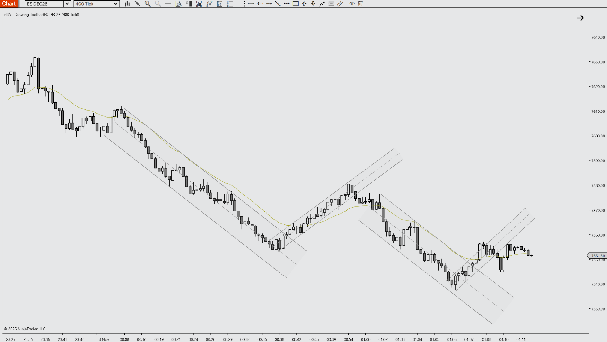

# Price Action Channel for NinjaTrader 8

A specialized Drawing Tool engineered for Price Action day trading. Draw a 3-point PATS trend channel in three clicks (base line, end of base line, parallel line), complete with a 50% midline, and reshape it with dedicated length, width and rotation handles.

---

## 📺 Video Walkthrough & Setup

Watch the complete breakdown of parameters, price action context, and chart examples on YouTube:

> **[▶ Click here to watch the full YouTube walkthrough](https://youtube.com/@icPriceAction)**

---

## 🆕 What's New in v1.4.0

- **Click-through fill:** The channel is now selected and moved by its lines only (base, parallel, or midline when shown). Order lines, other drawings and Chart Trader inside a large channel stay fully clickable.
- **Ray-style drawing:** After the first click, the base line previews as a ray through the cursor to the chart edge (solid up to the cursor, dashed beyond it), so you can line it up with swing points further out before setting the length.
- **Live channel preview:** After the second click, the full channel (fill, both lines and midline) previews as you set the width, with dashed ray guides beyond the line ends.
- **Fix:** A hidden midline (Show 50% Midline off) no longer catches clicks.

---

## ☕ Support the Project

All tools by **icPriceAction** are **100% free and open-source for personal trading use**. There are no paywalls, subscriptions, or locked features and there never will be!

Developing, optimizing for zero latency on multiple charts/instruments, and maintaining documentation and releases takes a **considerable amount of personal time and ongoing effort**. 

If this tool saves you screen time, improves your execution, or cleans up your charts, buying a coffee is the best way to support continued development:

  

> **[☕ Support Development on Buy Me a Coffee](https://buymeacoffee.com/icpriceaction)**

---

## ⚡ Key Features

- **3-Click PATS Channel:** Click 1 starts a ray-style base line that follows the cursor, click 2 sets its angle and length, and click 3 sets the parallel line with a live preview of the finished channel. A dashed 50% midline is drawn halfway between the lines, and the channel can be drawn into the chart's right margin.
- **Precise Editing Handles:** When selected, drag a corner to change length and width without changing the angle, drag a blue dot to rotate around the opposite end of the midline, drag a square to move just one line in or out, or drag any line to move the whole channel.
- **Stays Out of Your Way:** The channel fill is click-through, so even very large channels never block order lines, Chart Trader or other drawings underneath.
- **Square or Vertical Ends:** Choose ends that stay at 90 degrees on screen at any zoom, or vertical ends so both lines always start and end on the same bars. Optionally extend all lines to the left and/or right edge of the chart.
- **PATS & Context Aligned:** Designed for Price Action principles and disciplined futures execution.
- **Zero Chart Lag:** Native C# execution optimized to prevent UI freezes on high-frequency tick charts.
- **Clean Visuals:** Complementary default palette that preserves candlestick clarity without chart clutter.
- **Fully Customizable:** Configure line and midline styles, fill color, opacity, channel ends and extensions via the native NT8 settings panel.

---

## ⚠️ Prerequisites & Data Requirements

- Works on any chart, instrument and bar type.
- No Tick Replay, Calculate mode or market depth required.

---

## 📥 Installation Guide

1. Head to the **[Releases](https://github.com/icPriceAction/price-action-channel/releases)** tab of this repository.
2. Download the latest release `.zip` file.
   - *Note: Do NOT extract or unzip the file.*
3. Open **NinjaTrader 8**.
4. In the Control Center, navigate to:
   `Tools` ➔ `Import` ➔ `NinjaScript Add-On...`
5. Select the downloaded `.zip` file and click **Open**.
6. A success dialog will appear confirming the tool has been imported.
7. Open any chart, open the Drawing Tools menu, and select **Price Action Channel**.

---

## ⚙️ Parameters & Configuration

| Parameter | Group | Type | Default | Description |
| :--- | :--- | :--- | :--- | :--- |
| Channel Ends | 1. General | Square / Vertical | Square | Square: ends at 90 degrees on screen. Vertical: both lines start and end on the same bars. |
| Extend Lines Left | 1. General | Bool | False | Extends the base line, parallel line and midline to the left edge of the chart. |
| Extend Lines Right | 1. General | Bool | False | Extends the base line, parallel line and midline to the right edge of the chart. |
| Lines | 2. Visuals | Stroke | `#8E8E8E`, Solid, 1.5 px | Color, dash style and width of the base and parallel lines. |
| Channel Fill Color | 2. Visuals | Brush | `#C6C6C6` | Color used to shade the area between the base and parallel lines. |
| Fill Opacity (%) | 2. Visuals | Int (0–100) | 10 | Opacity of the channel fill. 0 turns the fill off. |
| Show 50% Midline | 2. Visuals | Bool | True | Draws a line halfway between the base and parallel lines. When off, the midline also can't be clicked. |
| Midline | 2. Visuals | Stroke | `#8E8E8E`, Dash, 1 px | Color, dash style and width of the 50% midline. |
| Base Start | Data | Anchor | Set by click 1 | Time and price where the base line starts. |
| Base End | Data | Anchor | Set by click 2 | Time and price where the base line ends. |
| Channel Offset | Data | Anchor | Set by click 3 | A point on the parallel line, which sets the channel width. |

---

## 📝 Changelog

- **v1.4.0** - Click-through fill (select and move the channel by its lines only); ray-style base line preview after click 1; full channel preview with ray guides after click 2; hidden midline no longer catches clicks.
- **v1.3.1** - Initial public release. Cleaned and optimized by icPriceAction.
- **v1.3.0** - New geometry model with Square/Vertical channel ends; line settings moved to Stroke properties (v1.2.x color/width settings still load).

---

## 🐛 Bug Reports & Feature Requests

Found an issue or have an enhancement idea?
Please submit an issue on the [Issues tab](https://github.com/icPriceAction/price-action-channel/issues).

---

## License

Free for personal trading use. Commercial resale, redistribution, or repackaging is strictly prohibited. See [LICENSE](LICENSE).

---

## ⚖️ Disclaimer

Futures trading involves substantial risk of loss and is not suitable for every investor. All indicators, drawing tools, strategies, and documentation provided by **icPriceAction** are for educational and analytical purposes only. Nothing herein constitutes financial or investment advice. Automated strategies can lose money and may behave differently in live markets than in simulation or backtests.

NinjaTrader® is a registered trademark of NinjaTrader, LLC. icPriceAction is an independent developer with no official affiliation to NinjaTrader, LLC.